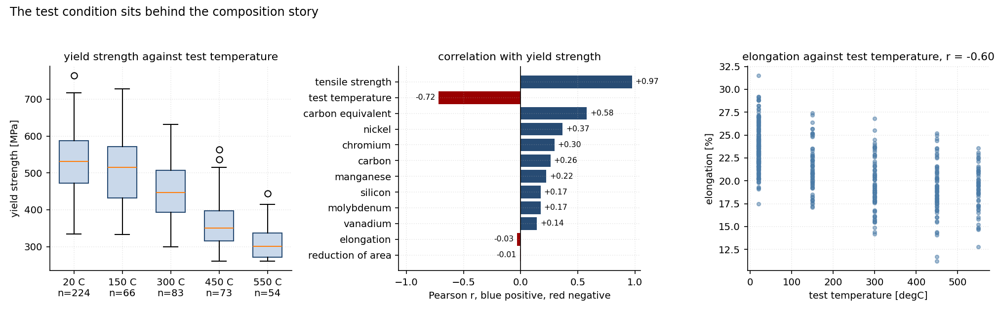
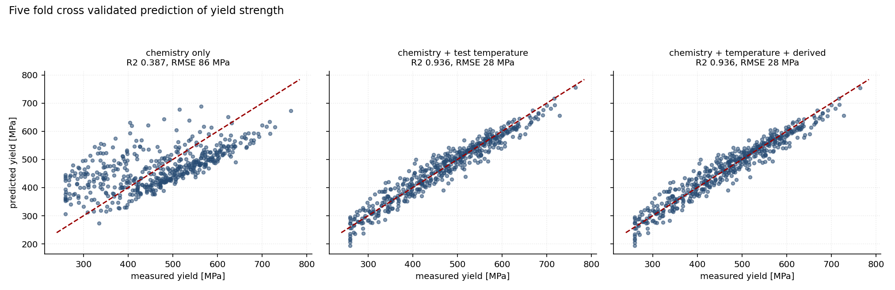
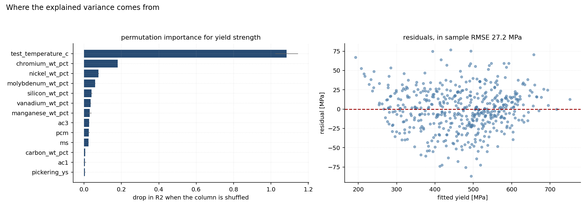
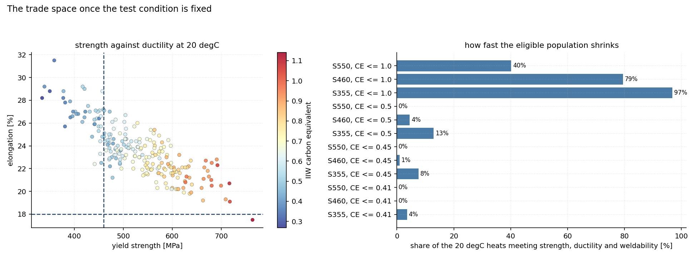
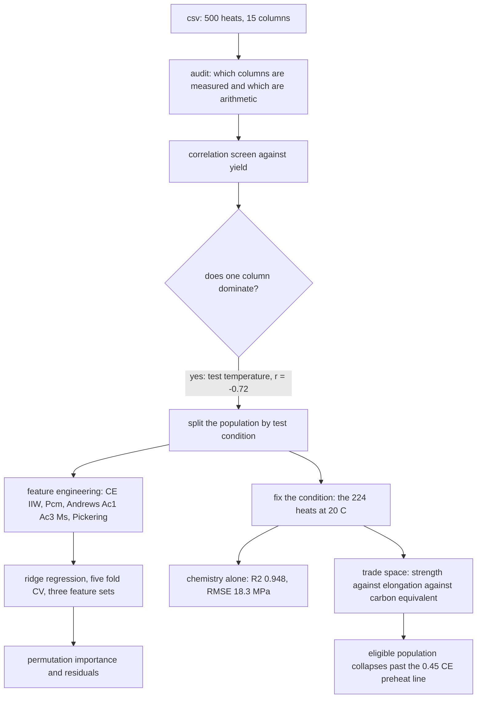

# Low-alloy steel tensile tests: what the chemistry explains, and what the test condition hides

A csv of 500 low-alloy steel tensile tests, seven alloying elements, a carbon equivalent, and the
three properties a mill cares about: yield strength, tensile strength and elongation. The project
asks a question that sounds simple and is not, which is how much of the measured strength the
chemistry accounts for.

Two things in the file decide the answer, and both of them punish a careless reading. The tests
were run at five different temperatures, so pooling them lets the test condition pass for
chemistry. And the pooling also destroys a real effect, because the strength against ductility
compromise that everyone expects is only visible inside one test condition.

[](https://colab.research.google.com/github/daniswaramp/low-alloy-steel-tensile-properties/blob/main/steel_tensile_analysis.ipynb)

## What the analysis found

| Question | Answer | Number |
|---|---|---|
| What drives measured yield in the pooled file? | The test temperature, not the chemistry | r = -0.72 against 0.58 for the carbon equivalent |
| How much does chemistry explain, pooled? | Under half the variance | R² 0.387, RMSE 86 MPa |
| How much does chemistry explain at one test condition? | Almost all of it | R² 0.948, RMSE 18.3 MPa on the 224 heats at 20 °C |
| Do the derived metallurgical features help? | No measurable gain | 0.936 against 0.936 for yield |
| Is there a strength against ductility compromise? | Yes, hidden by pooling | r = -0.03 pooled against -0.815 at 20 °C |
| Is the population weldable? | Mostly not | 92 percent of the S355 group sits above 0.45 carbon equivalent |

## The test condition sits behind the composition story



Left, yield by test temperature: the median falls from about 525 MPa at 20 °C to about 300 MPa at
550 °C. Middle, the correlation ranking: one numeric column dominates, and it is not an alloying
element. Right, elongation follows the same downslope, which is the first clue that the
strength-ductility picture in this file will depend on which condition a heat was tested at.

## Models, and what each one is allowed to see



Three configurations, one ridge regression, one five fold split. Chemistry alone predicts poorly
because it is being asked to explain a spread that is mostly thermal. Adding the test temperature
lifts R² from 0.387 to 0.936 and cuts the error from 86 MPa to 28 MPa. The four derived
metallurgical features change nothing measurable, which is worth stating rather than dressing up.



Permutation importance on the full model, and the residuals of the in-sample fit. The test
temperature is worth more than every chemistry column combined. Among the elements, chromium and
nickel rank above carbon, which I would not push far: the elements move together here, so the
credit between them is partly arbitrary, and the carbon equivalent, being a combination of them,
correlates more strongly than any single one.

## Strength, ductility and weldability at one condition



Fix the test condition and the classical picture appears. Yield against elongation is -0.815, and
elongation against the carbon equivalent is -0.743. The right panel counts how fast the eligible
population collapses: of the 224 heats at 20 °C, 221 clear S355, but 92 percent of them need
preheat before welding, and nothing in the file reaches S355 with ductility and weldability intact
in any meaningful number. That is a statement about this file, not about the industry.

## The route



## Worked equations

IIW carbon equivalent, the column the file already carries. Recomputing it from the composition
reproduces the shipped column to within 0.001, which is how I know it is arithmetic rather than a
measurement:

$$CE_{IIW} = C + \frac{Mn}{6} + \frac{Cr + Mo + V}{5} + \frac{Ni + Cu}{15}$$

- $C$, $Mn$, $Cr$, $Mo$, $V$, $Ni$ and $Cu$ are the mass fractions in weight percent.
- This file carries no copper column, so that term is zero for every heat.

Ito and Bessyo's cracking parameter, which weights the same elements for cold cracking rather than
for hardenability. Copper and boron are absent from the file, so those terms drop out:

$$P_{cm} = C + \frac{Si}{30} + \frac{Mn + Cu + Cr}{20} + \frac{Ni}{60} + \frac{Mo}{15} + \frac{V}{10} + 5B$$

- The symbols are the same mass fractions, $Si$ joining them and $B$ being boron in weight percent.
- The file has no copper and no boron column, so those two terms drop out and the parameter is computed from the seven elements it does carry.

Andrews' transformation temperatures, used as model inputs and as a physical sanity check on the
chemistry:

$$Ac_1 = 723 - 10.7Mn - 16.9Ni + 29.1Si + 16.9Cr$$

$$Ac_3 = 910 - 203\sqrt{C} - 15.2Ni + 44.7Si + 104V + 31.5Mo$$

$$M_s = 539 - 423C - 30.4Mn - 17.7Ni - 12.1Cr - 7.5Mo$$

- The symbols are mass fractions in weight percent, and the three temperatures come out in °C.
- $Ac_1$ is where austenite begins to form on heating, $Ac_3$ where the steel becomes fully austenitic, and $M_s$ where martensite would start on cooling.
- The relations as quoted omit the trace terms for arsenic, tungsten and vanadium. This file has no arsenic or tungsten column at all.

Pickering's ferrite-pearlite yield strength, the one relation here that needs a grain size the file
does not have, so d is fixed at 10 µm and the result is read as one term with a stated assumption.
Its median lands about 80 MPa below the measured median, and that gap is the size of the offset the
assumption carries:

$$\sigma_y = 15.4\left(3.5 + 2.1Mn + 5.4Si + 23C + \frac{1.13}{\sqrt{d}}\right)$$

- $\sigma_y$ is the yield strength in MPa, and the element symbols are mass fractions in weight percent.
- $d$ is the ferrite grain size in mm, and it is the one input the file does not carry, so it is fixed at 10 µm (0.01 mm) for every heat.
- The leading 15.4 is the unit conversion from the kgf/mm² the relation was written in.
- With those values the grain-size term contributes about 174 MPa and the whole expression lands near 391 MPa, against a measured median of 472 MPa.

The model is ridge regression on standardised features, which keeps collinear elements from
fighting over the same credit:

$$\hat{\beta} = \arg\min_{\beta}\left\{\sum_{i=1}^{n}\left(y_i - \beta_0 - \sum_{j} x_{ij}\beta_j\right)^2 + \alpha\sum_{j}\beta_j^2\right\}, \qquad \alpha = 1$$

- $y_i$ is the measured yield or tensile strength of heat $i$ in MPa, and $n$ is the number of heats in the fit.
- $x_{ij}$ is feature $j$ for that heat, standardised to zero mean and unit variance before fitting, so the penalty treats every column equally.
- $\beta_0$ is the intercept, $\beta_j$ the coefficient on feature $j$, and the hat marks the fitted values.
- $\alpha$ is the penalty strength, set to 1. It shrinks the coefficients, which matters here because the alloying elements move together and unpenalised least squares would hand them arbitrary large opposing values.
- Because the inputs are standardised, the coefficients are comparable in size but are not physical sensitivities in MPa per weight percent.

Scored out of fold with five fold cross validation, on the coefficient of determination and the
error in MPa:

$$R^2 = 1 - \frac{\sum_i (y_i - \hat{y}_i)^2}{\sum_i (y_i - \bar{y})^2}, \qquad
RMSE = \sqrt{\frac{1}{n}\sum_i (y_i - \hat{y}_i)^2}$$

- $y_i$ is a measured strength, $\hat{y}_i$ the prediction for that heat, and $\bar{y}$ the mean of the measured values.
- $R^2$ is the share of the variance in the target the model accounts for, so 1 is perfect and 0 is what predicting the mean scores. $RMSE$ is the typical error in MPa.
- Both are computed out of fold, on predictions the model never saw during fitting, which is why they are lower than the in-sample numbers.

Importance is measured by permutation, the drop in R² when one column is shuffled thirty times,
because coefficients under collinearity are not a ranking:

$$\text{importance}_j = R^2(\text{full}) - \frac{1}{30}\sum_{k=1}^{30} R^2(\text{column } j
\text{ shuffled})$$

- The first term is the model's score on the data as it stands, the second its score with column $j$ shuffled, averaged over 30 shuffles so the answer does not depend on one lucky permutation.
- Shuffling destroys any real relationship between that column and the target while leaving its distribution alone, so the drop measures what the model was leaning on.
- It is used here instead of reading the coefficients, because collinear columns can carry large opposing coefficients that mean nothing individually.

## Methods and tools

- **Audit before modelling.** Recompute the derived columns, check the one relation that must hold
  (yield below tensile), look for duplicates and out-of-range values. Two of the fifteen columns
  turned out to be arithmetic.
- **Screen for confounds before fitting.** A correlation ranking against the target, then a check of
  whether the population can be pooled at all. This is the step that found the test temperature.
- **pandas 3 and numpy** for loading, the audit, the feature engineering and the groupings.
- **scikit-learn**: `Ridge(alpha=1)` inside a `Pipeline` with `StandardScaler`, `KFold(5)` with
  `cross_val_predict` for out-of-fold scoring, and `permutation_importance` for the ranking.
- **matplotlib** for the six charts, all written to `figures/` by the notebook.
- **Jupyter and nbconvert** so the notebook can be executed headlessly and its outputs verified
  rather than assumed.

## What this file cannot support

1. **No processing variables.** Grain size, cooling rate, finishing temperature and reduction ratio
   are all absent, and those are what a mill actually manipulates. The Pickering term carries an
   assumed grain size for that reason.
2. **Two columns are arithmetic.** The carbon equivalent and the weldability label follow from the
   chemistry, so a model that leans on them is leaning on a formula.
3. **No provenance I can verify.** The file has 500 rows, sequential ids of the form MAT-0001, and
   no origin I can confirm. The description that shipped with it named a different dataset (312
   heats, 13 elements), so I describe the file by what it contains and attribute it to nobody. Treat
   the numbers as a well formed exercise on tensile data, not as a record of a particular mill.

## Files

```
low_alloy_steel_tensile_properties_dataset.csv   500 heats, 15 columns
steel_tensile_analysis.ipynb                     the analysis, all numbers computed in place
figures/                                         six charts, written by the notebook
```

## Run it

```bash
pip install pandas numpy matplotlib scikit-learn
jupyter notebook steel_tensile_analysis.ipynb
```

The notebook loads the csv from its own folder, so it runs as shipped. Every figure and every
number quoted above is produced by a cell in it, and the notebook was executed end to end before
publishing.
